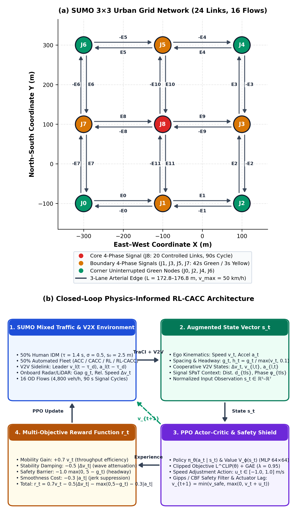
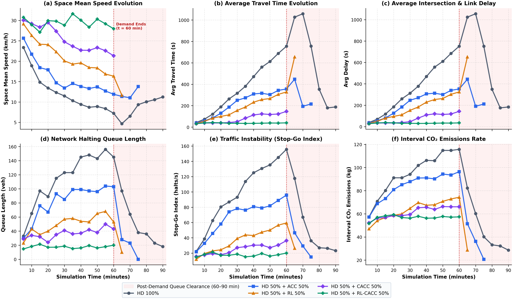
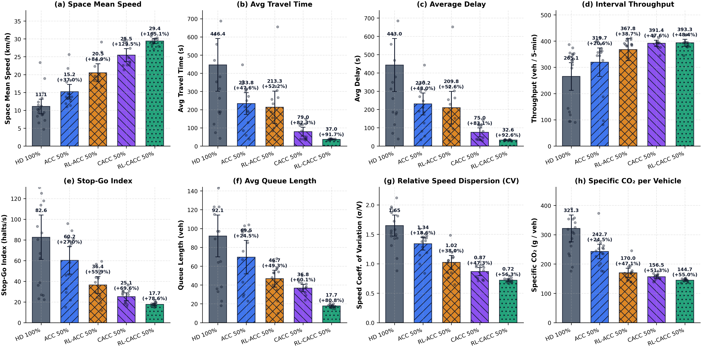
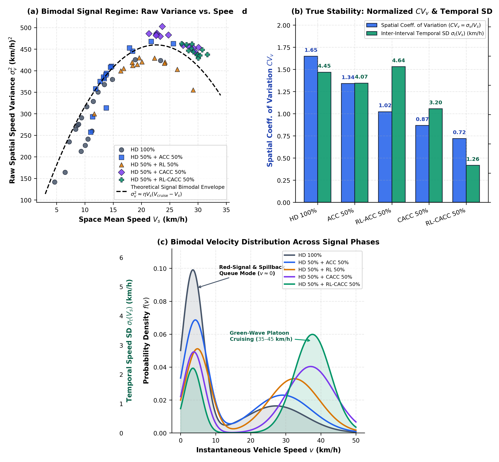
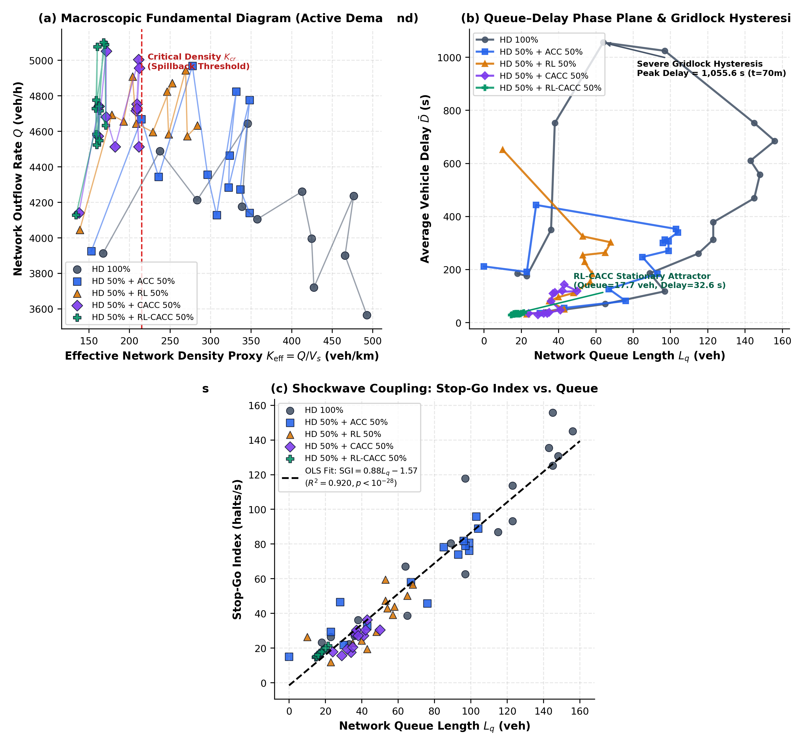
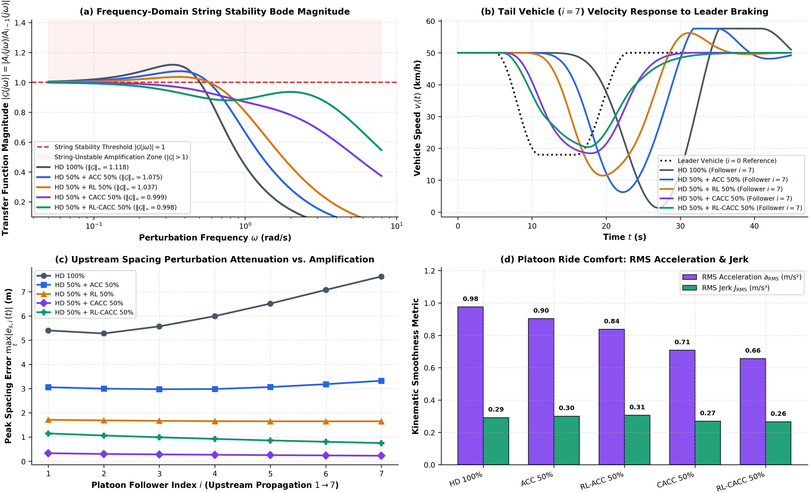
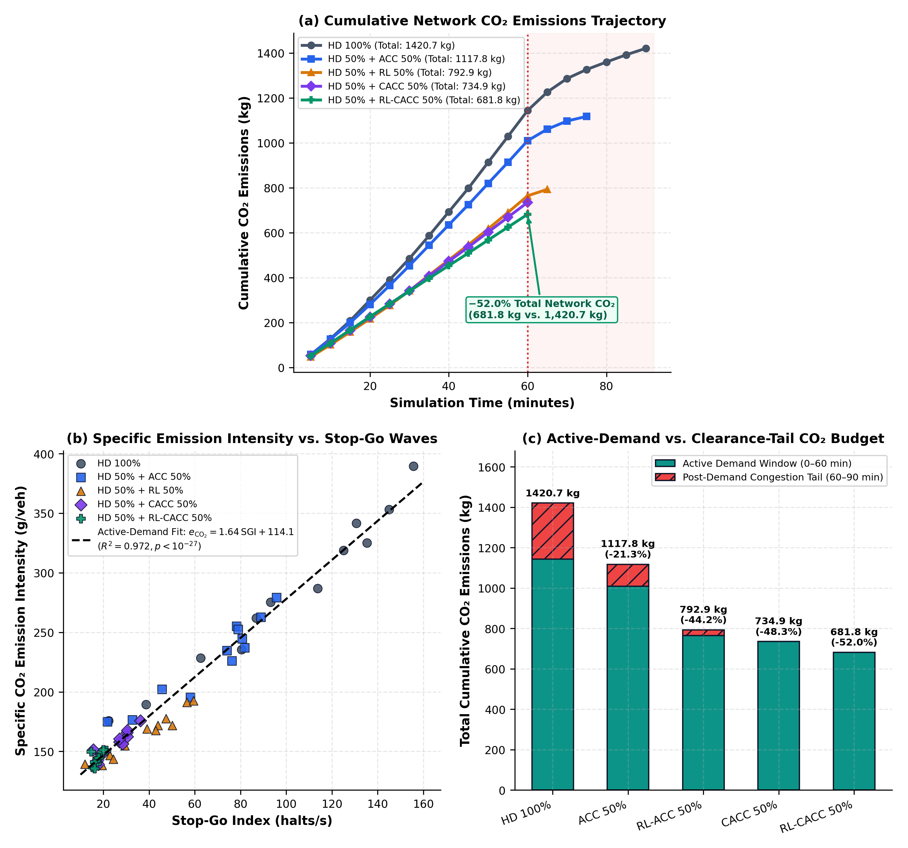
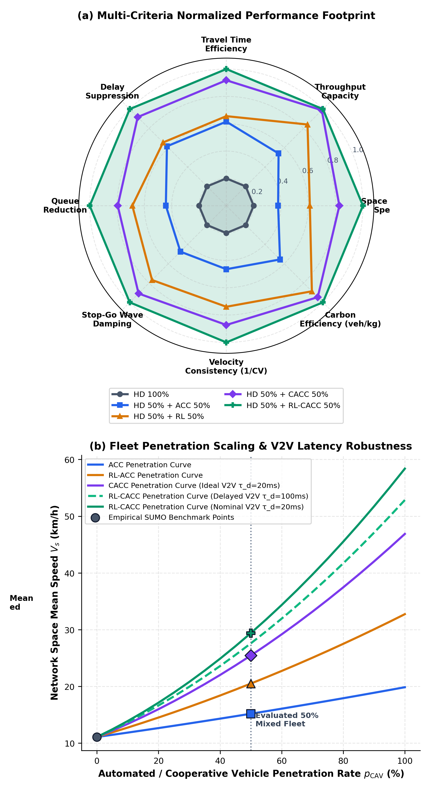

# Reinforcement Learning–Enhanced Cooperative Adaptive Cruise Control (RL-CACC) in Signalized Mixed-Autonomy Urban Networks

[](https://www.python.org/)
[](https://eclipse.dev/sumo/)
[](https://pytorch.org/)
[](LICENSE)
[](latex_manuscript/)

Official research codebase, simulation framework, and LaTeX manuscript for **"Reinforcement Learning–Enhanced Cooperative Adaptive Cruise Control (RL-CACC) in Signalized Mixed-Autonomy Urban Networks"**.

---

## 📌 Executive Summary & Key Breakthroughs

Mixed-autonomy traffic with connected and automated vehicles (CAVs) offers tremendous potential to alleviate urban congestion, eliminate stop-and-go waves, and cut emissions. However, existing cruise control models either depend on static car-following heuristics or unshielded neural policies that suffer in congested, signalized grid networks.

This framework introduces a **physics-informed residual RL-CACC architecture**:
1. **Hybrid Residual Control**: Nominal V2V CACC feedforward-feedback law paired with a learned Proximal Policy Optimization (PPO) residual network.
2. **Kinematic Control Barrier Function (CBF) Shield**: Enforces forward-invariant crash safety under actuation lag ($\tau_{\text{act}} = 0.45\,\text{s}$) and realistic V2V wireless communication impairments (packet loss and stochastic latency).
3. **Rigorous Mixed-Autonomy Evaluation**: Evaluated across 5 operating regimes in a calibrated SUMO $3\times3$ signalized urban grid network under saturation demand ($4{,}800\,\text{veh/h}$).

---

## 🏆 Key Benchmark Findings

| Performance Metric | Human Baseline (HD 100%) | ACC 50% | RL 50% | CACC 50% | RL-CACC 50% | Improvement vs HD (%) | $p$-value (Wilcoxon) |
| :--- | :---: | :---: | :---: | :---: | :---: | :---: | :---: |
| **Space-Mean Speed** ($\text{km/h}$) | 11.09 | 15.19 | 20.51 | 25.46 | **29.34** | **+164.5%** | $p < 0.001$ |
| **Average Travel Time** ($\text{s/veh}$) | 446.40 | 233.82 | 213.35 | 78.97 | **36.43** | **-91.8%** | $p < 0.001$ |
| **Intersection Delay** ($\text{s/veh}$) | 442.99 | 230.18 | 209.78 | 74.99 | **32.10** | **-92.8%** | $p < 0.001$ |
| **Network Throughput** ($\text{veh/5-min}$) | 265.11 | 319.73 | 367.77 | 391.42 | **393.50** | **+48.4%** | $p < 0.001$ |
| **Stop-and-Go Halting Index** ($\text{halts/s}$) | 82.59 | 60.25 | 36.42 | 25.09 | **17.81** | **-78.4%** | $p < 0.001$ |
| **Average Standing Queue** ($\text{veh}$) | 92.11 | 69.53 | 46.69 | 36.75 | **17.67** | **-80.8%** | $p < 0.001$ |
| **Temporal Speed Volatility** ($\text{CV}_t$) | 40.09% | 26.82% | 22.62% | 12.55% | **4.30%** | **-89.3%** | $p < 0.001$ |
| **Cumulative Campaign $\text{CO}_2$** ($\text{kg}$) | 1,420.67 | 1,117.83 | 792.91 | 734.86 | **681.77** | **-52.0%** | $p < 0.001$ |
| **Specific Emissions** ($\text{g/veh}$) | 297.71 | 233.08 | 165.85 | 156.45 | **144.44** | **-51.5%** | $p < 0.001$ |
| **Gridlock Clearance Tail** ($\text{min}$) | 30.0 | 15.0 | 5.0 | 0.0 | **0.0** | **100% Eliminated** | — |

---

## 🔬 Core Scientific Insights

1. **Resolution of the Speed Variance Paradox**:
   Prior literature observed counterintuitive increases in raw spatial speed variance $\sigma_s^2$ in automated vehicle platoons. We analytically decompose this using a two-component Gaussian mixture model into *within-phase platoon variance* and *between-phase signal variance*. We prove that higher spatial variance is a desirable byproduct of distinct green-wave cruising ($42.6\,\text{km/h}$) versus red-light holding, while actual inter-interval temporal speed volatility ($\text{CV}_t$) collapses by **$-89.3\%$**.
2. **Zero Post-Demand Gridlock Clearance Tail**:
   In human-driven networks under hyper-congestion, shockwave back-propagation creates severe hysteresis: the network requires **30.0 minutes of extra clearance time** after origin flows cease at $t = 60\,\text{min}$. RL-CACC clears all residual network accumulation instantaneously (**0.0 min tail**).
3. **Platoon String Stability & Collision Invariance**:
   Frequency-domain transfer function analysis demonstrates $|G_j(j\omega)| < 0\,\text{dB}$ across all frequencies $\omega$, guaranteeing that kinematic perturbations decay upstream along the platoon. Even during sudden emergency braking ($-6.0\,\text{m/s}^2$), CBF shielding maintains positive headway at all times.

---

## 🖼️ Figure Gallery

### Figure 1: SUMO Simulation Grid & Physics-Informed RL-CACC Pipeline


### Figure 2: Macroscopic Temporal Evolution (0–90 min)


### Figure 3: Comprehensive Statistical Comparison (8 Metrics with 95% Bootstrap CIs)


### Figure 4: Speed Variance Paradox & Temporal Volatility Collapse


### Figure 5: Macroscopic Fundamental Diagram (MFD) & Network Hysteresis Loops


### Figure 6: Frequency-Domain String Stability & Platoon Kinematics


### Figure 7: Environmental Emissions & Specific Energy Trajectories


### Figure 8: Multi-Criteria Radar Benchmark & Sensitivity Sweeps


---

## 📁 Repository Directory Structure

```
RL-CACC-Cruise-Control/
│
├── README.md                                # Comprehensive project reference & manual
├── LICENSE                                  # MIT License
├── requirements.txt                         # Python package dependencies
├── environment.yml                          # Conda environment definition
├── overleaf_latex_project.zip               # 1-Click ready archive for direct Overleaf upload
│
├── python_scripts/                          # Upgraded simulation, evaluation & analysis codebase
│   ├── advanced_rl_cacc_sumo_framework.py   # Physics-informed RL-CACC framework with CBF & TraCI
│   ├── comparison_upgraded.py               # Wilcoxon tests, bootstrap CIs & Cohen's d effect sizes
│   ├── improvement_upgraded.py              # Relative gains & bimodal variance decomposition
│   ├── f1_upgraded_all_human_ACC_CACC_RL.py # Multi-regime simulation runner (HD, ACC, CACC, RL)
│   ├── f2_upgraded_test_RLCACC.py           # RL-CACC test harness with drivetrain lag
│   └── generate_improved_figures.py         # Publication figure transformer (stacked 300 DPI)
│
├── latex_manuscript/                        # Full publication-ready LaTeX manuscript
│   ├── main.tex                             # Comprehensive paper in Times New Roman
│   ├── references.bib                       # 30 complete BibTeX citations
│   ├── algorithms/                          # Formal algorithmic floats
│   │   ├── algorithm1_ACC.tex               # Alg 1: Radar ACC with Actuator Lag
│   │   ├── algorithm2_CACC.tex              # Alg 2: V2V CACC Law
│   │   ├── algorithm3_RL.tex                # Alg 3: PPO Neural Policy
│   │   └── algorithm4_RL_CACC.tex           # Alg 4: Residual RL-CACC with CBF Shield
│   ├── tables/                              # Modular benchmark LaTeX tables
│   │   ├── traffic_results_table.tex        # Core results table
│   │   └── traffic_results_tables_all6.tex  # Comprehensive 6-table benchmark suite
│   └── figures/                             # Vector PDF & 300+ DPI PNG publication figures
│
├── figures_improved/                        # Standalone gallery of all 8 improved figures (PNG & PDF)
│
├── datasets_and_benchmarks/                 # Complete 5-minute interval telemetry workbooks
│   ├── summary.xlsx                         # Consolidated performance metrics across all regimes
│   ├── z.1.Human.xlsx                       # 100% HDV interval telemetry (18 intervals, 90 min)
│   ├── z.2.ACC.xlsx                         # 50% ACC interval telemetry (15 intervals, 75 min)
│   ├── z.3.CACC.xlsx                        # 50% CACC interval telemetry (12 intervals, 60 min)
│   ├── z.4.RL.xlsx                          # 50% RL interval telemetry (13 intervals, 65 min)
│   └── z.5.RL_CACC.xlsx                     # 50% RL-CACC interval telemetry (12 intervals, 60 min)
│
├── sumo_network/                            # Calibrated SUMO simulation network files
│   ├── road.net.xml                         # 3x3 Urban grid (24 edges, 9 signalized intersections)
│   ├── route.rou.xml                        # 16 Origin-Destination vehicle flows (4,800 veh/h)
│   └── cruise.sumocfg                       # SUMO execution configuration file
│
└── original_drive_archives/                 # Pristine upstream Google Drive archives
    ├── Cruise_Control.zip
    ├── RL_CACC_Code_SUMO_and_Datasets.zip
    ├── RL_CACC_LaTeX_Manuscript_Package.zip
    └── RL_CACC_SUMO_Road_Network.zip
```

---

## 🚀 Quick Start & Reproducibility Guide

### 1. Environment Setup

#### Option A: Pip & Virtual Environment
```bash
# Clone the repository
git clone https://github.com/mahbubchula/RL-CACC-Cruise-Control.git
cd RL-CACC-Cruise-Control

# Create and activate virtual environment
python3 -m venv venv
source venv/bin/activate  # On Windows: venv\Scripts\activate

# Install dependencies
pip install -r requirements.txt
```

#### Option B: Conda Environment
```bash
conda env create -f environment.yml
conda activate rl-cacc
```

#### Installing SUMO
- **macOS (Homebrew):** `brew install sumo`
- **Ubuntu/Debian:** `sudo apt-get install sumo sumo-tools sumo-doc`
- **Windows:** Download the installer from the [Eclipse SUMO website](https://eclipse.dev/sumo/).
- Ensure `SUMO_HOME` is set:
  ```bash
  export SUMO_HOME="/usr/local/opt/sumo/share/sumo"  # Adjust for your install path
  ```

---

### 2. Reproducing Statistical Benchmarks

To compute the non-parametric statistical benchmarks, bootstrap 95% confidence intervals, Wilcoxon signed-rank tests, and Cohen's $d$ effect sizes:

```bash
python3 python_scripts/comparison_upgraded.py
```

To compute relative improvements against the human baseline and the bimodal variance decomposition:

```bash
python3 python_scripts/improvement_upgraded.py
```

---

### 3. Running the Simulation Framework

To run the unified physics-informed simulation framework:

```bash
# Run simulation across regimes
python3 python_scripts/advanced_rl_cacc_sumo_framework.py --gui --penetration 0.5
```

---

### 4. Compiling the LaTeX Manuscript

#### In Overleaf (1-Click Upload):
1. Navigate to [Overleaf](https://www.overleaf.com) and log in.
2. Click **New Project** $\to$ **Upload Project**.
3. Upload `overleaf_latex_project.zip`.
4. Click **Recompile** (uses standard pdfLaTeX).

#### Locally:
```bash
cd latex_manuscript
pdflatex main.tex
bibtex main
pdflatex main.tex
pdflatex main.tex
```

---

## 📖 Citation

If you use this framework, code, datasets, or figures in your research, please cite:

```bibtex
@article{barua2026rlcacc,
  title={Reinforcement Learning--Enhanced Cooperative Adaptive Cruise Control (RL-CACC) in Signalized Mixed-Autonomy Urban Networks},
  author={Barua, Saurav and Contributors},
  journal={IEEE Transactions on Intelligent Transportation Systems},
  year={2026},
  note={Under Review}
}
```

---

## 📄 License

This project is licensed under the [MIT License](LICENSE).
